# NF-Calendar

**English** · [Русский](README.ru.md) · [More plugins by Nomber](https://nomberobsidian.github.io/)

A calendar view for [Obsidian](https://obsidian.md) with built-in daily, weekly and monthly notes and
rule-based templates: per weekday, per date, per date range, "last Friday of the month", even/odd weeks and more.

This is a fork of [Calendar](https://github.com/liamcain/obsidian-calendar-plugin) by **Liam Cain**, released under
the MIT license (see [LICENSE](LICENSE)). All credit for the original calendar view goes to him; the original README is
kept in [README.original.md](README.original.md).

- Plugin id: `nf-calendar`, version 1.0.1
- Requires Obsidian **1.8.7+**, works on desktop and mobile
- Interface in **English and Russian**
- Source and releases: [github.com/NOMBER/NF-Calendar](https://github.com/NOMBER/NF-Calendar)

## One plugin instead of three

This plugin replaces **Calendar + the core Daily Notes plugin + Periodic Notes** (weekly / monthly part).
It keeps its own settings for daily, weekly and monthly notes and finds and creates the notes itself.

It does not read or enable other plugins, except for the **Import from Daily Notes / Periodic Notes** button and a one-time import of older settings from those plugins.

## Calendar

Click a day to open or create its daily note (Ctrl/Cmd+click opens it in a new pane). Click a week number to open the weekly note.

- Dots under days can mean: the note exists (the default), done tasks, word count, or nothing
- Hover an empty day to preview which template would be used, and the first lines of that file
- Language: Auto / English / Русский (Auto follows Obsidian)

## Go to date

Click the month title (for example "Nov 2026") to switch year, pick a month, or type a specific day. Works on mobile too. Right-click the title still opens the main menu.

- A switch chooses whether a month click opens the calendar or that month's statistics
- The day field shows whether the note already exists, then opens or creates it
- Date fields can use DD.MM.YYYY, YYYY.MM.DD, or MM.DD.YYYY (with `.`, `-`, or `/`)

## Random daily note

Opens a random existing daily note. In the Go to date dialog, **Open random note** expands the period options; the dice button opens one immediately with your saved settings.

- Periods: all notes, a year, a month, the last N days, or a date range — you can add several, and the pick uses all of them
- Optional **Skip empty** (a note with only headings and empty list items counts as empty)
- The command palette item and an optional ⋯ menu item use the same saved settings

<p align="center">
  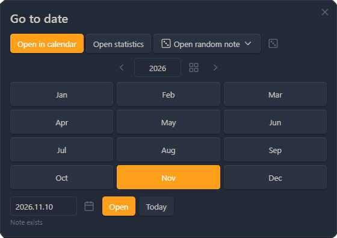
</p>

## Templates

For a daily note the plugin uses, in order: the first matching special rule, then the weekday template, then the default template. Weekly and monthly notes use rules (if enabled for that type) against the first day of the period, then that type's default template.

- Templates are chosen by the **note's date**, not by today
- One weekday template per day of the week; leave a day empty to use the default
- If a template file is missing, you get a notice and the next candidate is used

<p align="center">
  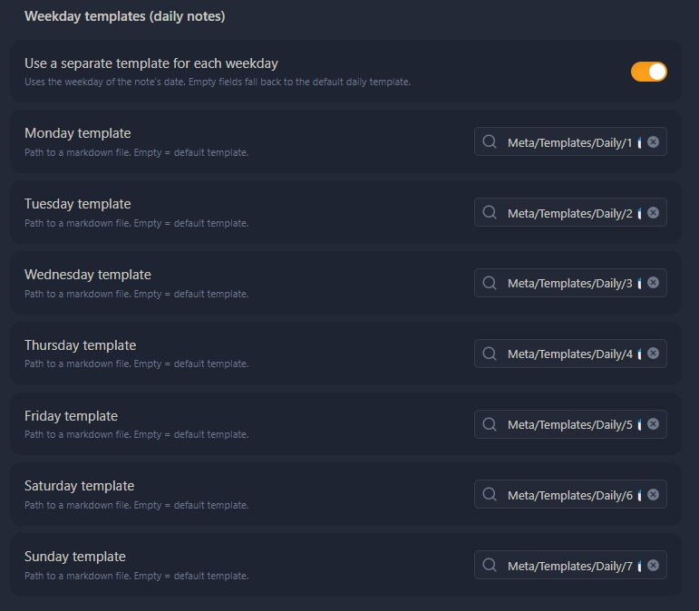
</p>

### Placeholders

All placeholders use the **note's date** (the first day of the period for weekly and monthly notes):

| Placeholder | Result |
| --- | --- |
| `{{title}}`, `{{date}}` | the note's file name (with that note type's format) |
| `{{time}}` | current time, `HH:mm` |
| `{{date:FMT}}`, `{{time:FMT}}` | the note date with a moment.js format, e.g. `{{date:dddd, D MMMM}}` |
| `{{date+1d:FMT}}`, `{{date-2w}}` | date arithmetic; units `y q m w d h s` |
| `{{yesterday}}`, `{{tomorrow}}` | previous / next day in the note format |
| `{{monday:FMT}}` … `{{sunday:FMT}}` | that weekday of the note's week |
| `{{carryover}}` | open tasks from the previous daily note |

`{{carryover}}` (daily notes only) looks back up to 31 days and takes at most 200 tasks. The previous note is not changed. During batch creation it stays empty, so the same tasks are not copied into every future note. Templater's `<% … %>` is left unchanged.

## Special rules

Rules are checked top to bottom. Each has a condition, the note types it applies to (daily / weekly / monthly), and a template file. You can rename, enable, reorder, or delete them. Put more specific rules above broader ones.

- **Dates:** every year on a day and month (birthdays, holidays), a date range, or a one-off `YYYY-MM-DD`
- **Month:** a range of days (`1–7`, or `25–5` wrapping over the month end), the last N days, first or last day of the month or quarter
- **Weekdays and cycles:** several weekdays, the N-th weekday of the month (or the last), week N, even or odd ISO week, every N days from a chosen date
- **Marks:** a holiday from the holidays folder, or a day marked important

<p align="center">
  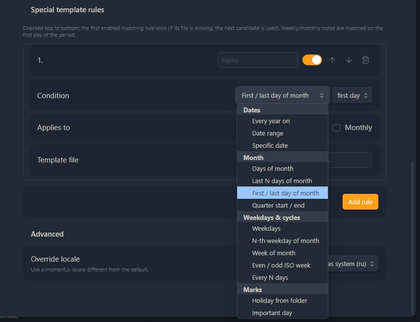
</p>

<details>
<summary>Rule examples</summary>

| Rule | Condition | Applies to | Template |
| --- | --- | --- | --- |
| Mom's birthday | Every year on `05-14` | Daily | `Templates/Birthday.md` |
| Vacation | Date range `2026-07-01` → `2026-07-14` | Daily | `Templates/Vacation.md` |
| Monthly review | N-th weekday: last Friday | Daily | `Templates/Review.md` |
| Sprint planning | Even ISO week | Weekly | `Templates/Sprint.md` |
| Workout | Weekdays Mon, Wed, Fri | Daily | `Templates/Gym.md` |
| Holiday | Holiday from folder | Daily | `Templates/Holiday.md` |

</details>

## Holidays folder

Point the plugin to a folder (for example `Meta/Dates`) whose note names start with a date. Holidays match every year by day and month.

Supported prefixes include `13.03 Birthday`, `03-13 …`, `13/03 …`, `1999-03-13 - Natalia's birthday`, and `1000-09-01 Knowledge Day` (the separator after the date is optional). Two-part dates follow the **Day first / Month first** setting; `YYYY-MM-DD` is always unambiguous. You can also set a custom pattern (`DD_MM`, `YYYY.MM.DD`, …).

- The calendar shows 🎉 on those days; hover to see the names
- Age is shown when the note has a real year (1900 or later); placeholder years like `1000` show no age
- Click the 🎉 mark or use the day's context menu to open the holiday notes
- Holidays also appear in Upcoming and statistics, and can be used as a special-rule condition
- Names that do not start with a recognizable date are counted in settings

<p align="center">
  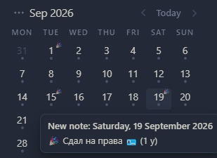
</p>

## Important days

Right-click a day and choose **Mark as important…** to give it a title, a color, and an optional "prepare N days before" highlight (0–30). A note file is not required.

- Several events can share one day (one color, separate rows in the list)
- A collapsible **Upcoming important days** list under the calendar opens the note on click
- Filter All / Holidays / Important; right-click (or long-press) a row to complete or dismiss it

<p align="center">
  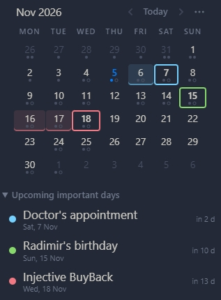
</p>

## The ⋯ menu

The ⋯ button in the calendar header and a right-click on the month title open the same menu. Every action is also a command — assign hotkeys in Obsidian Settings → Hotkeys.

- Place the button left or right of "‹ Today ›", before the month title, on its own row, or hide it (right-click the title still works)
- In Settings → ⋯ menu you can show, hide, and reorder items
- Toggles on the menu turn holiday marks and important-day highlights on or off (display only)

<p align="center">
  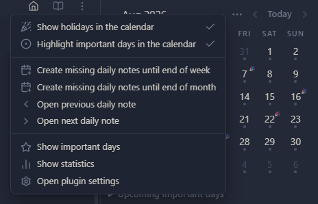
</p>

## Create missing notes

Commands create missing daily notes until the end of the week or month, for the week back or the whole week, or for a future month shown in the calendar. Existing notes are always skipped and never changed.

- A confirmation lists the dates and the template chosen for each
- You can start from today or from the open daily note
- Right-click a day to create or open that day's note

## Apply a template

From the command, the ⋯ menu, or the day's context menu, apply the template that the rules would use for that date.

- An empty note is filled at once
- For a non-empty note you choose: append, insert at the beginning, replace (asks for confirmation), or skip (the default; Esc does the same)

## Open today's note on startup

Off by default. When it is on, NF-Calendar opens today's daily note when Obsidian starts, and creates it if needed (without the confirmation dialog). If the note is already open, that tab is focused.

- You can turn the core Daily notes plugin off completely
- If you keep it, turn off its own "Open daily note on startup" option to avoid duplicates

## Organize daily notes

From the command palette or Settings → Daily notes, move daily notes into year folders, year+month folders, or back to one flat folder: `Daily/2026-10-30.md` → `Daily/2026/2026-10-30.md`.

- **Back up your vault before the first run.** A preview is shown first; nothing moves until you press **Move**
- Nothing is overwritten; Obsidian updates links if "Automatically update internal links" is on
- **Undo last organize** moves the notes back
- You can store new notes in the same layout, and optionally remove empty year/month folders left behind

<p align="center">
  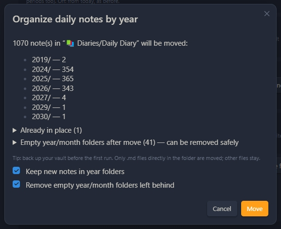
</p>

<details>
<summary>If a flat duplicate appears</summary>

A second file such as `Daily/2026-11-05.md` next to `Daily/2026/2026-11-05.md` is usually created by the core **Daily notes** plugin or **Periodic Notes**, which do not know about year folders. Turn off that plugin (or at least its startup option). Delete the flat file if it is empty. If the real note looks missing, check the year folder, the trash, and File recovery.

</details>

## Statistics

A month view with a table and charts: words, done and open tasks, holidays, and a current all-tasks-done streak. Click a day to open its note.

- **✓** means the note has tasks and all of them are done
- Charts: words per day, done vs open tasks, cumulative words, and a donut of days with ✓ / without ✓ / without a note
- The chosen view, metric, and chart type are remembered

<p align="center">
  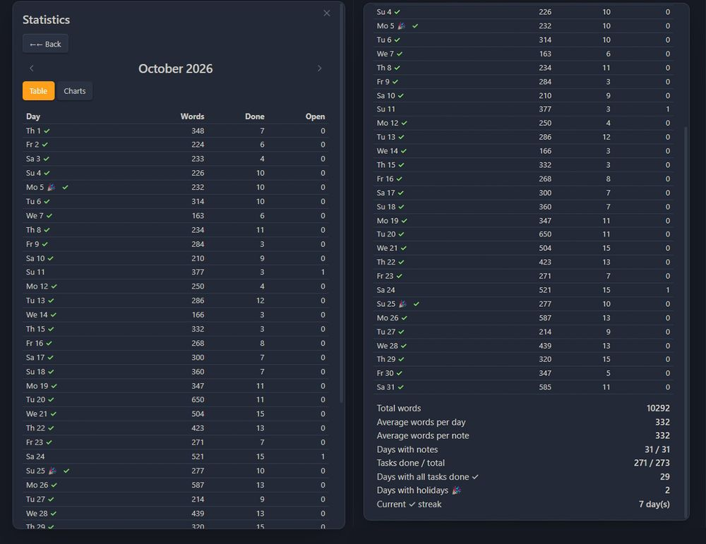
</p>

<p align="center">
  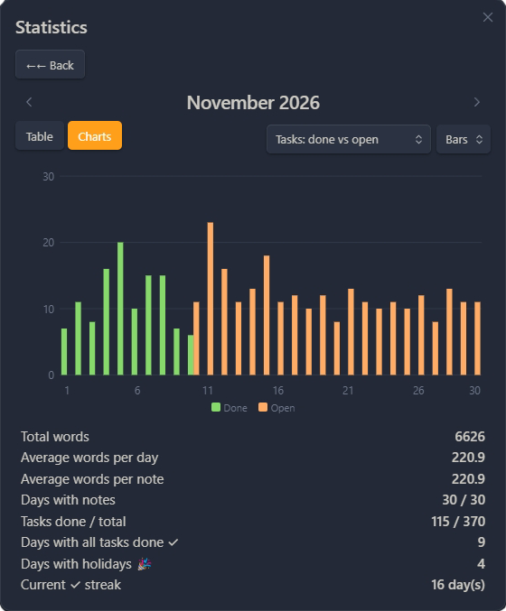
  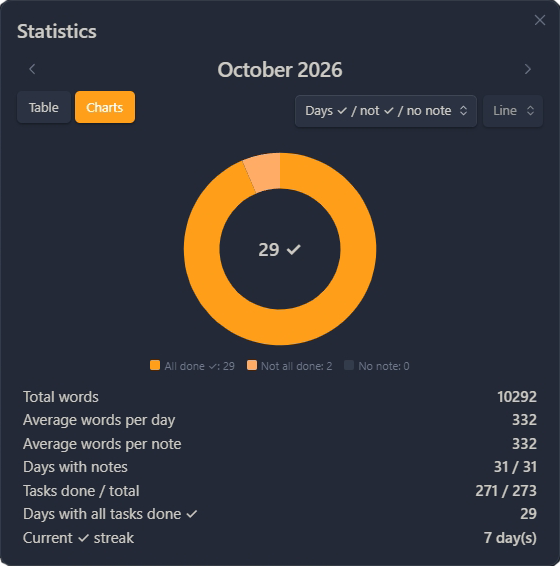
</p>

<p align="center">
  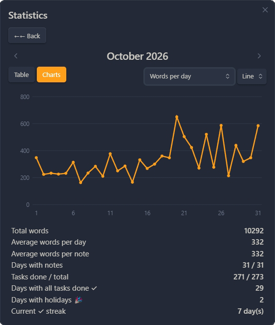
  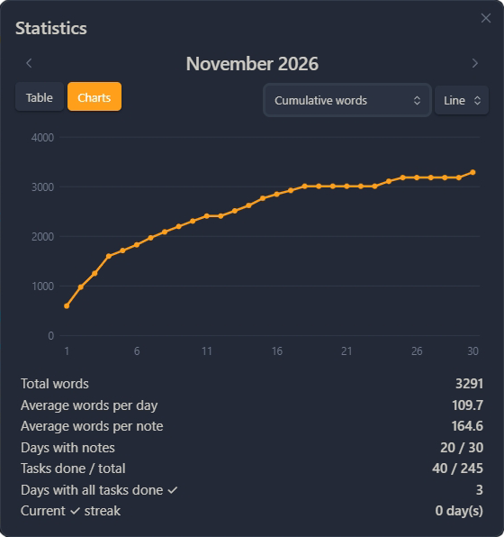
</p>

## Previous / next daily note

Jumps to the nearest *existing* daily note before or after the open one. Gaps are skipped and nothing is created.

## Installation

The plugin is **not yet in the Obsidian community plugin catalog**. Install it from [GitHub Releases](https://github.com/NOMBER/NF-Calendar/releases):

0. **Upgrading from an earlier test build** (plugin id `calendar-weekday-templates`, named "Calendar (Weekday Templates)"): disable it and delete the folder `<your vault>/.obsidian/plugins/calendar-weekday-templates/` first. This release uses the id `nf-calendar`; settings from the old id are not migrated, so set them again.
1. Download `nf-calendar.zip` (or `main.js`, `manifest.json` and `styles.css`) from the [latest release](https://github.com/NOMBER/NF-Calendar/releases/latest).
2. Unzip it into `<your vault>/.obsidian/plugins/`. You should get a folder `nf-calendar/` with the three files.
3. Restart Obsidian, or click "Reload plugins" under Community plugins, then enable **NF-Calendar**.
4. It is best to disable the original Calendar. Once this plugin is set up, Daily Notes and Periodic Notes can be disabled too.

On the first start after an upgrade, the plugin **once** imports the folder, format, and template from the core Daily Notes and Periodic Notes plugins (if they were configured), plus older weekday templates. After that it no longer reads other plugins' settings. On a fresh install, the import only runs when you click **Import from Daily Notes / Periodic Notes**.

## Templater compatibility

- The plugin does not run Templater code. `<% … %>` is copied into the new note unchanged. If Templater's **"Trigger Templater on new file creation"** is on, Templater processes the new note itself.
- After **Apply template**, run Templater's "Replace templates in the active file" if you need those tags processed.
- In text brought in by `{{carryover}}`, `<%` is escaped so Templater does not run it.

## Limitations

- Command names in the command palette use the language chosen when the plugin loaded. Reload the plugin after changing the language.
- "Insert at beginning" with a template that has its own frontmatter can produce a second `---` block inside the note.
- The Periodic Notes 1.0 beta format (calendar sets) is not supported by the import; Periodic Notes 0.x and the core Daily Notes plugin are.
- Quarterly and yearly notes are not supported.

## Security

- Folders, file name formats, and template paths are checked so they cannot point outside the vault or into `.obsidian`
- The plugin writes only through Obsidian's vault API and does not contact the network
- Existing notes are never overwritten; the only way to change one is **Apply template**, after you pick an action

More detail is in [docs/ARCHITECTURE.md](docs/ARCHITECTURE.md) (in Russian).

<details>
<summary>Known issues / dependency advisories</summary>

`npm audit` on 2026-11-03 reported 48 vulnerabilities, almost all in dev tooling. The release bundle includes the Svelte 3 runtime and `obsidian-calendar-ui`; `obsidian` and `moment` are provided by Obsidian.

Svelte 3 advisories are mostly about server-side rendering, which this plugin does not use. One remaining DOM-clobbering advisory stays open until the UI moves to a newer Svelte. A moment path-traversal advisory is mitigated by accepting only normal locale ids. Most other findings are in eslint, jest, and the build toolchain, which do not ship in the plugin.

</details>

## Development

```bash
npm install --legacy-peer-deps
npm run build   # lint (svelte-check, eslint) + rollup -> main.js
npm test        # jest unit tests (src/core/__tests__)
npm run dist    # build + test + dist/ (zip and the three plugin files)
```

- `src/core`: logic without Obsidian (templates, dates, rules, settings, stats, i18n), with tests in `src/core/__tests__`
- `src/io`: finding, creating, and reading notes
- `src/ui`: calendar view, menus, settings, and dialogs
- `src/main.ts`: plugin lifecycle and commands

See [docs/ARCHITECTURE.md](docs/ARCHITECTURE.md) and [CHANGELOG.md](CHANGELOG.md). Issues and pull requests are welcome: keep `src/core` free of Obsidian imports, add tests for logic changes, run `npm run build` and `npm test`, and update both languages in `src/core/i18n.ts`.

## License

MIT. See [LICENSE](LICENSE). Original Calendar plugin © 2021 Liam Cain; this fork keeps the same license. Author: Nomber.

## Support

If this plugin is useful to you, you can support its development:

[](https://donatre.github.io/)

More plugins by Nomber: [nomberobsidian.github.io](https://nomberobsidian.github.io/)
