# NF-Calendar

[English](README.md) · **Русский** · [Другие плагины от Nomber'a](https://nomberobsidian.github.io/)

Календарь для [Obsidian](https://obsidian.md) со встроенными ежедневными, недельными и месячными заметками и шаблонами по правилам: по дню недели, по дате, по диапазону, «последняя пятница месяца», чётные/нечётные недели и другое.

Это форк плагина [Calendar](https://github.com/liamcain/obsidian-calendar-plugin) от **Liam Cain** (лицензия MIT, см. [LICENSE](LICENSE)). Вся заслуга исходного календаря — его; оригинальное описание сохранено в [README.original.md](README.original.md).

- id: `nf-calendar`, версия 1.0.0
- Требуется Obsidian **1.4.10+**, работает на десктопе и на мобильных
- Интерфейс на **английском и русском**
- Исходный код и релизы: [github.com/NOMBER/NF-Calendar](https://github.com/NOMBER/NF-Calendar)

## Один плагин вместо трёх

Плагин заменяет **Calendar + базовые «Ежедневные заметки» + Periodic Notes** (недельная и месячная части).
Он сам хранит настройки ежедневных, недельных и месячных заметок, сам их находит и создаёт.

Чужие плагины он не читает и ничего в них не включает — только по кнопке **«Импортировать из Daily Notes / Periodic Notes»** и один раз при переносе старых настроек.

## Календарь

Клик по дню открывает или создаёт ежедневную заметку (Ctrl/Cmd+клик — в новой панели). Клик по номеру недели открывает недельную заметку.

- Точки под днями могут означать: есть заметка (по умолчанию), выполненные задачи, количество слов или ничего
- Наведите на пустой день, чтобы увидеть, какой шаблон будет взят, и начало этого файла
- Язык: Auto / English / Русский (Auto повторяет язык Obsidian)

## Переход к дате

Клик по названию месяца (например «Nov 2026») открывает окно: сменить год, выбрать месяц или ввести конкретный день. Работает и на мобильных. Правый клик по названию по-прежнему открывает главное меню.

- Переключатель задаёт, что откроет клик по месяцу — календарь или статистику этого месяца
- Поле дня показывает, есть ли уже заметка, и открывает или создаёт её
- Поля дат можно показывать как ДД.ММ.ГГГГ, ГГГГ.ММ.ДД или ММ.ДД.ГГГГ (разделитель `.`, `-` или `/`)

## Случайная заметка

Открывает случайную существующую ежедневную заметку. В окне перехода к дате кнопка **«Открыть случайную заметку»** раскрывает выбор периода; кнопка с кубиком сразу открывает заметку по сохранённым настройкам.

- Периоды: все заметки, год, месяц, последние N дней или диапазон дат — можно добавить несколько, заметка берётся из их объединения
- Дополнительно — **«Пропускать пустые»** (пустой считается заметка, где только заголовки и пустые пункты списков)
- Команда в палитре и необязательный пункт меню ⋯ используют те же сохранённые настройки

<p align="center">
  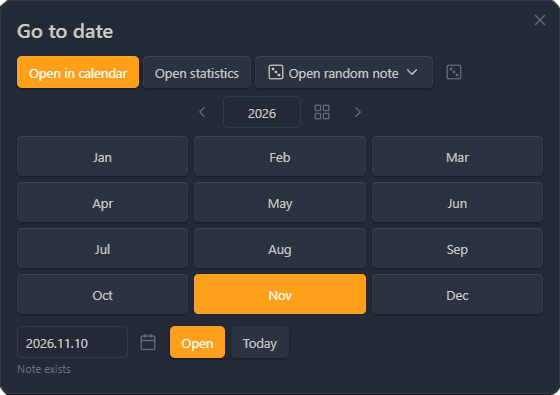
</p>

## Шаблоны

Для ежедневной заметки плагин берёт, по порядку: первое подходящее особое правило, затем шаблон дня недели, затем шаблон по умолчанию. Для недельных и месячных заметок правила (если они включены для этого типа) проверяются по первому дню периода, иначе берётся шаблон по умолчанию этого типа.

- Шаблон выбирается по **дате заметки**, а не по сегодняшнему дню
- Свой шаблон на каждый день недели; пустое поле — шаблон по умолчанию
- Если файла шаблона нет, показывается уведомление и берётся следующий кандидат

<p align="center">
  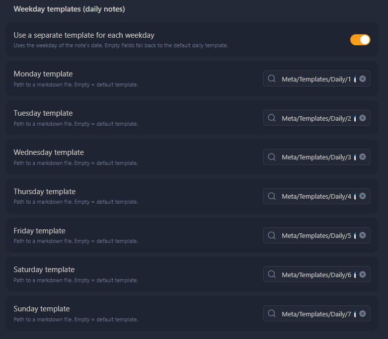
</p>

### Подстановки

Все подстановки считаются от **даты заметки** (для недельных и месячных — от первого дня периода):

| Подстановка | Результат |
| --- | --- |
| `{{title}}`, `{{date}}` | имя файла заметки (в формате этого типа) |
| `{{time}}` | текущее время, `HH:mm` |
| `{{date:FMT}}`, `{{time:FMT}}` | дата заметки в формате moment.js, например `{{date:dddd, D MMMM}}` |
| `{{date+1d:FMT}}`, `{{date-2w}}` | сдвиг даты; единицы `y q m w d h s` |
| `{{yesterday}}`, `{{tomorrow}}` | предыдущий / следующий день в формате заметки |
| `{{monday:FMT}}` … `{{sunday:FMT}}` | этот день недели в неделе заметки |
| `{{carryover}}` | невыполненные задачи из предыдущей ежедневной заметки |

`{{carryover}}` (только ежедневные заметки) ищет до 31 дня назад и берёт не более 200 задач. Предыдущая заметка не меняется. При массовом создании поле остаётся пустым, чтобы одни и те же задачи не попали в каждую будущую заметку. Код Templater (`<% … %>`) не трогается.

## Особые правила

Правила проверяются сверху вниз. У каждого есть условие, типы заметок (день / неделя / месяц) и файл шаблона. Правила можно переименовывать, включать, переставлять и удалять. Более узкие правила ставьте выше широких.

- **Даты:** ежегодно в день и месяц (дни рождения, праздники), диапазон дат или разовая дата `YYYY-MM-DD`
- **Месяц:** диапазон дней (`1–7` или `25–5` через конец месяца), последние N дней, первый или последний день месяца или квартала
- **Дни недели и циклы:** несколько дней недели, n-й день недели месяца (или последний), N-я неделя, чётная или нечётная ISO-неделя, каждые N дней от выбранной даты
- **Отметки:** праздник из папки праздников или день, отмеченный как важный

<p align="center">
  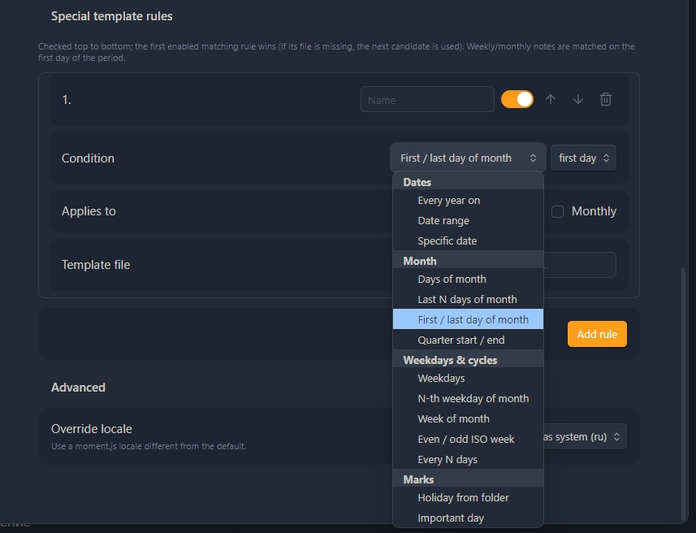
</p>

<details>
<summary>Примеры правил</summary>

| Правило | Условие | Для | Шаблон |
| --- | --- | --- | --- |
| День рождения мамы | Ежегодно `05-14` | День | `Templates/Birthday.md` |
| Отпуск | Диапазон `2026-07-01` → `2026-07-14` | День | `Templates/Vacation.md` |
| Итоги месяца | n-й день недели: последняя пятница | День | `Templates/Review.md` |
| Планирование спринта | Чётная ISO-неделя | Неделя | `Templates/Sprint.md` |
| Тренировка | Пн, Ср, Пт | День | `Templates/Gym.md` |
| Праздник | Праздник из папки | День | `Templates/Holiday.md` |

</details>

## Праздники из папки

Укажите папку (например `Meta/Dates`), где названия заметок начинаются с даты. Совпадение — каждый год по дню и месяцу.

Поддерживаются префиксы вроде `13.03 День рождения`, `03-13 …`, `13/03 …`, `1999-03-13 - День Рождения Натальи`, `1000-09-01 День знаний` (разделитель после даты не обязателен). Короткие даты читаются по настройке **«сначала день / сначала месяц»**; `ГГГГ-ММ-ДД` однозначна всегда. Можно задать свой шаблон (`DD_MM`, `YYYY.MM.DD`, …).

- В календаре такие дни отмечены 🎉; при наведении видны названия
- Возраст показывается, если в имени настоящий год (1900 или позже); у «заглушек» вроде `1000` возраст скрыт
- Клик по уголку 🎉 или контекстное меню дня открывают заметки-праздники
- Праздники видны в «Ближайших» и в статистике и доступны как условие особого правила
- Названия без распознанной даты считаются в настройках

<p align="center">
  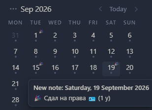
</p>

## Важные дни

Правый клик по дню → **«Пометить как важный…»**: название, цвет и необязательная подсветка «подготовиться за N дней» (0–30). Файл заметки для этого не нужен.

- Несколько событий могут быть в один день (общий цвет, отдельные строки в списке)
- Под календарём — сворачиваемый список **«Ближайшие важные дни»**; клик по строке открывает заметку
- Фильтр Все / Праздники / Важные дни; правый клик (или долгое нажатие) по строке — завершить или убрать

<p align="center">
  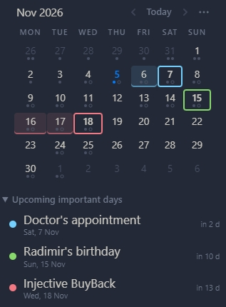
</p>

## Меню ⋯

Кнопка ⋯ в шапке календаря и правый клик по названию месяца открывают одно и то же меню. Все действия есть и в палитре команд — горячие клавиши назначаются в Настройки Obsidian → Горячие клавиши.

- Кнопку можно поставить слева или справа от «‹ Сегодня ›», перед названием месяца, отдельной строкой или скрыть (правый клик по названию всё равно работает)
- В Настройках → Меню ⋯ пункты можно показывать, скрывать и менять местами
- Переключатели в меню включают и выключают отметки праздников и важных дней (только отображение)

<p align="center">
  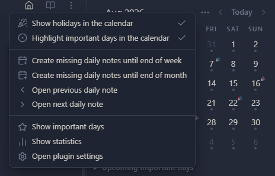
</p>

## Создание недостающих заметок

Команды создают недостающие ежедневные заметки до конца недели или месяца, с начала недели или за всю неделю, либо на будущий месяц, показанный в календаре. Существующие заметки всегда пропускаются и не меняются.

- В окне подтверждения — список дат и выбранный для каждой шаблон
- Можно считать период от сегодня или от открытой ежедневной заметки
- Правый клик по дню создаёт или открывает заметку этого дня

## Применить шаблон

Команда, пункт меню ⋯ или контекстное меню дня применяют тот шаблон, который правила выбрали бы для этой даты.

- Пустая заметка заполняется сразу
- Если в заметке уже есть текст, можно дописать в конец, вставить в начало, заменить (с подтверждением) или пропустить (действие по умолчанию; Esc делает то же)

## Открывать заметку дня при запуске

По умолчанию выключено. Если включить, при запуске Obsidian плагин открывает сегодняшнюю ежедневную заметку и при необходимости создаёт её (без окна подтверждения). Если заметка уже открыта, переключается на эту вкладку.

- Базовый плагин Daily notes можно полностью отключить
- Если вы его оставляете, выключите у него «Open daily note on startup», иначе появятся дубли

## Разложить ежедневные заметки

Из палитры команд или Настройки → Ежедневные заметки можно перенести заметки в папки по годам, по годам и месяцам или обратно в одну плоскую папку: `Daily/2026-10-30.md` → `Daily/2026/2026-10-30.md`.

- **Перед первым запуском сделайте резервную копию хранилища.** Сначала открывается предпросмотр; пока вы не нажмёте **«Переместить»**, ничего не меняется
- Ничего не перезаписывается; ссылки обновятся, если в Obsidian включено автообновление ссылок
- **«Отменить последнюю раскладку»** возвращает заметки на место
- Новые заметки можно сразу хранить в той же раскладке; пустые папки года/месяца можно удалить

<p align="center">
  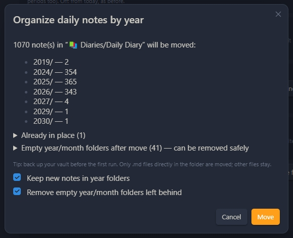
</p>

<details>
<summary>Если появилась «плоская» копия</summary>

Второй файл вроде `Daily/2026-11-05.md` рядом с `Daily/2026/2026-11-05.md` обычно создаёт встроенный плагин **Daily notes** или **Periodic Notes**: они не знают о папках по годам. Отключите тот плагин (или хотя бы его автооткрытие). Плоский файл удалите, если он пустой. Если кажется, что настоящая заметка пропала, проверьте папку года, корзину и «Восстановление файлов».

</details>

## Статистика

Окно по месяцу: таблица и графики — слова, выполненные и открытые задачи, праздники и текущая серия дней, где все задачи закрыты. Клик по дню открывает заметку.

- **✓** означает: в заметке есть задачи и все они выполнены
- Графики: слова по дням, выполненные и открытые задачи, слова нарастающим итогом и кольцевая диаграмма «дни с ✓ / без ✓ / без заметки»
- Выбранный вид, показатель и тип графика запоминаются

<p align="center">
  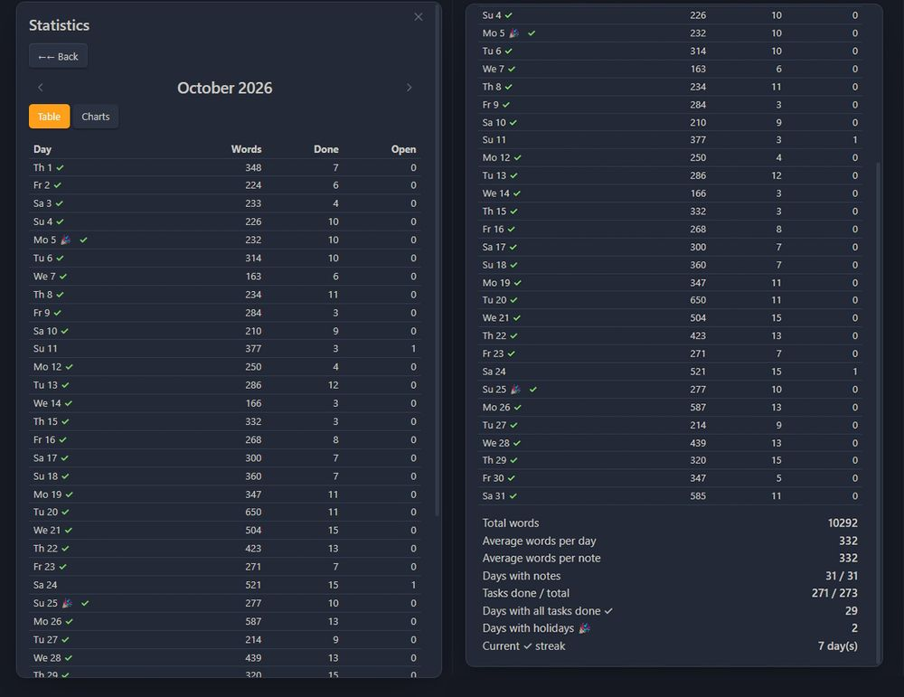
</p>

<p align="center">
  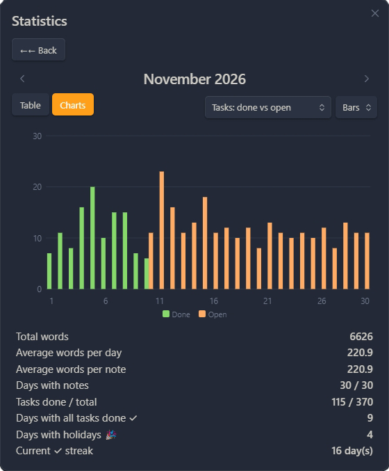
  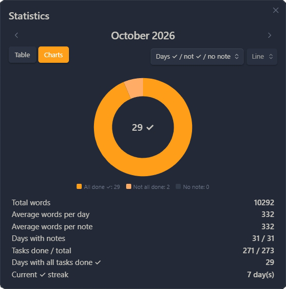
</p>

<p align="center">
  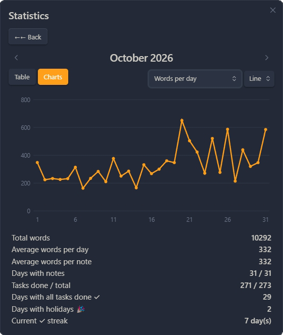
  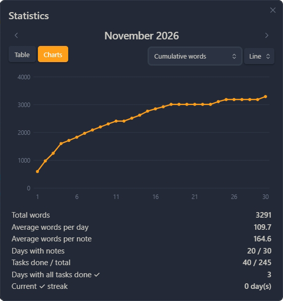
</p>

## Предыдущая / следующая заметка

Переход к ближайшей **существующей** ежедневной заметке до или после открытой. Пропуски в днях не важны, новые заметки не создаются.

## Установка

Плагин **пока не в каталоге** сообщества Obsidian. Ставьте из [релизов на GitHub](https://github.com/NOMBER/NF-Calendar/releases):

0. **Обновление с более ранней тестовой сборки** (id `calendar-weekday-templates`, «Calendar (Weekday Templates)»): отключите старый плагин и удалите папку `<хранилище>/.obsidian/plugins/calendar-weekday-templates/`. В этом релизе id — `nf-calendar`; настройки со старого id не переносятся, задайте их заново.
1. Скачайте `nf-calendar.zip` (или `main.js`, `manifest.json`, `styles.css`) со [страницы последнего релиза](https://github.com/NOMBER/NF-Calendar/releases/latest).
2. Распакуйте zip в `<хранилище>/.obsidian/plugins/` — получится папка `nf-calendar/` с тремя файлами.
3. Перезапустите Obsidian или нажмите «Обновить» в списке сторонних плагинов и включите **NF-Calendar**.
4. Оригинальный Calendar лучше выключить. Daily Notes и Periodic Notes после настройки тоже можно выключить: они больше не нужны.

При первом запуске после обновления плагин **один раз** переносит папку, формат и шаблон из базовых «Ежедневных заметок» и Periodic Notes (если они были настроены), а также прежние шаблоны дней недели. После этого чужие настройки не читаются. При новой установке импорт выполняется только кнопкой **«Импортировать из Daily Notes / Periodic Notes»**.

## Совместимость с Templater

- Плагин не выполняет код Templater. `<% … %>` копируется в новую заметку как есть. Если в Templater включён **«Trigger Templater on new file creation»**, он обработает новую заметку сам.
- После **«Применить шаблон»** при необходимости запустите команду Templater «Replace templates in the active file».
- В тексте из `{{carryover}}` последовательность `<%` экранируется, чтобы Templater её не выполнял.

## Ограничения

- Названия команд в палитре берутся на языке, выбранном при загрузке плагина. После смены языка перезагрузите плагин.
- «Вставить в начало» с шаблоном, у которого свой frontmatter, может дать второй блок `---` внутри заметки.
- Формат Periodic Notes 1.0-beta (calendar sets) импортом не поддерживается; поддерживаются Periodic Notes 0.x и базовые «Ежедневные заметки».
- Квартальные и годовые заметки не поддерживаются.

## Безопасность

- Папки, форматы имён и пути шаблонов проверяются: путь не может выйти из хранилища или попасть в `.obsidian`
- Плагин пишет только через API хранилища Obsidian и не обращается к сети
- Существующие заметки не перезаписываются; изменить заметку можно только командой **«Применить шаблон»**, после вашего выбора

Подробнее — в [docs/ARCHITECTURE.md](docs/ARCHITECTURE.md).

## Разработка

```bash
npm install --legacy-peer-deps
npm run build   # lint (svelte-check, eslint) + rollup → main.js
npm test        # jest: тесты в src/core/__tests__
npm run dist    # build + test + dist/ (zip и три файла)
```

Структура: `src/core` — логика без Obsidian (тесты в `src/core/__tests__`), `src/io` — работа с хранилищем, `src/ui` — календарь, меню, настройки и окна, `src/main.ts` — жизненный цикл и команды. Подробно — [docs/ARCHITECTURE.md](docs/ARCHITECTURE.md) и [CHANGELOG.md](CHANGELOG.md).

## Лицензия

MIT. См. [LICENSE](LICENSE). Оригинальный Calendar © 2021 Liam Cain; этот форк использует ту же лицензию. Автор: Nomber.

## Поддержать проект

Если плагин полезен, можно поддержать разработку:

[](https://donatre.github.io/)

Другие плагины от Nomber'a: [nomberobsidian.github.io](https://nomberobsidian.github.io/)
